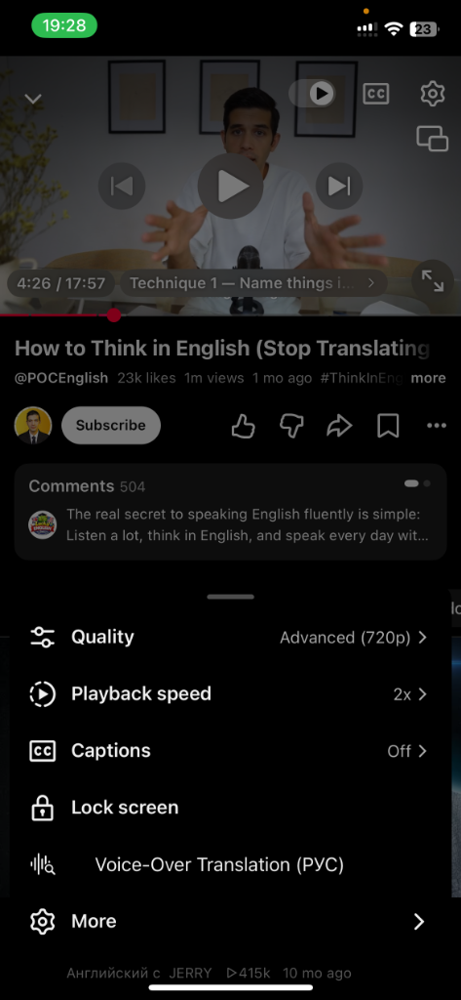
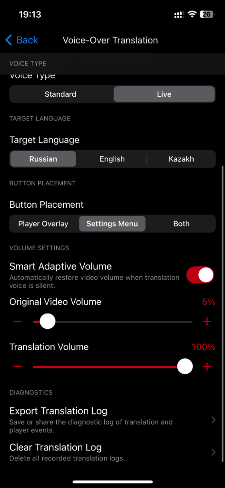

# YTVOT — Автономный мод голосового перевода для YouTube на iOS

[🇬🇧 **Read in English (README.md)**](README.md) | [📦 **Скачать готовый IPA (v1.0.0)**](https://github.com/Amizx2/YTVOT/releases/download/v1.0.0/YouTube_VOT_1.0.0.ipa) | [🧩 **Скачать YTVOT.dylib**](https://github.com/Amizx2/YTVOT/releases/download/v1.0.0/YTVOT.dylib)

**YTVOT** — это независимый, автономный iOS-твик, добавляющий синхронный нейросетевой голосовой перевод видео в официальное приложение YouTube на iPhone и iPad.

Проект основан на наработках [voice-over-translation](https://github.com/ilyhalight/voice-over-translation) и [vot.js](https://github.com/FOSWLY/vot.js), но полностью переписан на чистый Objective-C++ / UIKit и отделен от любых сторонних твиков.

Мод собирается в виде отдельной динамической библиотеки `YTVOT.dylib` и rootless `.deb` пакета. Его можно внедрить в **любой** YouTube: чистый оригинальный клиент, YTKACE, YTLite, uYouEnhanced и др.

---

## 📸 Скриншоты работы твика

<p align="center">
  
  &nbsp;
  
  &nbsp;
  
</p>

---

## Возможности

- **Универсальная совместимость**: работает со стоковым YouTube и любыми сборками (YTKACE, YTLite, uYouEnhanced).
- **Синхронизация звука через Phase-Locked Loop (PLL)**: устраняет рассинхрон аудиодорожки. Микро-коррекции скорости ($\pm 12\%$) плавно удерживают речь синхронно с видеорядом:

$$
\Delta t = t_{\text{video}} - t_{\text{audio}}, \quad \text{rate} = \text{rate}_{\text{video}} \times (1.0 + \text{clamp}(\Delta t \times 0.2, -0.12, +0.12))
$$

- **Умное адаптивное приглушение (Smart Adaptive Ducking)**: фоновый сканер аудиофайла (`AVAssetReader`) определяет точные границы речи. Звук оригинального видео приглушается **только когда говорит переводчик**, и плавно нарастает в паузах.
- **Выбор голоса**: мужской, женский или автоматический.
- **Языки перевода**: русский (RU), английский (EN), казахский (KK).
- **Кнопка на плеере**:
  - **Одиночный тап**: включение и отключение перевода.
  - **Долгое нажатие (long-press)**: открытие окна настроек YTVOT.
- **Интеграция в меню видео**: пункт быстрого перевода прямо в стандартном меню действий плеера.
- **Интеграция в настройки YouTube**: раздел YTVOT в главном меню настроек приложения.
- **Авторизация в Яндекс**: встроенный вход через OAuth (WKWebView) для длинных видео.

---

## 🛠️ Сборка и упаковка IPA (macOS и Linux)

В репозитории есть готовые автоматические скрипты для сборки готового `YouTube_VOT.ipa` в 1 клик как на **macOS**, так и на **Linux / Kali**.

### 🍎 Вариант A: На macOS (`build_macos.sh`)

1. **Клонируйте репозиторий:**
```bash
git clone https://github.com/Amizx2/YTVOT.git
cd YTVOT
```

2. **Поместите чистый файл `YouTube.ipa`** в папку `YTVOT` (или укажите путь аргументом).

3. **Сделайте скрипт исполняемым и запустите:**
```bash
chmod +x build_macos.sh
./build_macos.sh YouTube.ipa
```

- **Быстрая перепаковка**: внедряет готовый `YTVOT.dylib` в IPA (~3 секунды).
- **С перекомпиляцией из исходников**: `./build_macos.sh --compile YouTube.ipa` (соберёт свежий dylib через Theos на Mac и упакует в IPA).

---

### 🐧 Вариант B: На Linux / Kali / Ubuntu (`build_kali.sh`)

1. **Клонируйте репозиторий:**
```bash
git clone https://github.com/Amizx2/YTVOT.git
cd YTVOT
```

2. **Поместите чистый файл `YouTube.ipa`** в папку `YTVOT` (или укажите путь аргументом).

3. **Сделайте скрипт исполняемым и запустите:**
```bash
chmod +x build_kali.sh
./build_kali.sh YouTube.ipa
```

Скрипт автоматически:
- Установит системные зависимости (clang, make, ldid, zip, ccache).
- Настроит RootHide Theos и iOS SDK.
- Скомпилирует `YTVOT.dylib` и `.deb` пакет.
- Распакует `YouTube.ipa`, внедрит `YTVOT.dylib` через утилиту [`Tools/macho_inject.py`](Tools/macho_inject.py), подпишет через `ldid` и упакует финальный `YouTube_VOT.ipa`.

---

## 💻 Сборка из исходников (компиляция твика)

Если нужно скомпилировать только `.dylib` и `.deb` пакеты без упаковки IPA:

### 1. На macOS (Theos)
```bash
export THEOS=~/theos
[ -d "$THEOS" ] || git clone --recursive https://github.com/roothide/theos.git "$THEOS"

make clean
make -j$(sysctl -n hw.ncpu) package FINALPACKAGE=1 THEOS_PACKAGE_SCHEME=rootless
```
Файлы появятся в `.theos/obj/YTVOT.dylib` и `packages/com.amizx2.ytvot_1.0.0_iphoneos-arm64.deb`.

### 2. На Linux / Kali / Ubuntu
```bash
chmod +x build_kali.sh
./build_kali.sh
```
*(При запуске без аргументов скрипт компилирует `.deb` пакет и извлекает `YTVOT.dylib` в текущую папку).*

---

## 📱 Способы установки

### Вариант 1: Через Sideloadly / ESign (инжекция dylib)
1. Скачайте чистый `YouTube.ipa` и [YTVOT.dylib](https://github.com/Amizx2/YTVOT/releases/download/v1.0.0/YTVOT.dylib).
2. В Sideloadly откройте **Advanced Options** ➔ **Inject Dylibs/Frameworks** ➔ выберите `YTVOT.dylib`.
3. Подпишите и установите приложение на устройство.

### Вариант 2: TrollStore / Джейлбрейк (.deb)
1. Скачайте [com.amizx2.ytvot_1.0.0_iphoneos-arm64.deb](https://github.com/Amizx2/YTVOT/releases/download/v1.0.0/com.amizx2.ytvot_1.0.0_iphoneos-arm64.deb).
2. Установите через TrollStore, Sileo или Zebra.

### Вариант 3: Через утилиту Azule CLI (macOS / Linux)
```bash
azule -i YouTube.ipa -o YouTube_VOT.ipa -f YTVOT.dylib
```

---

## Лицензия

Распространяется под лицензией GNU General Public License v3.0 (GPLv3).
